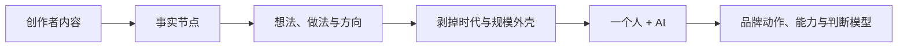
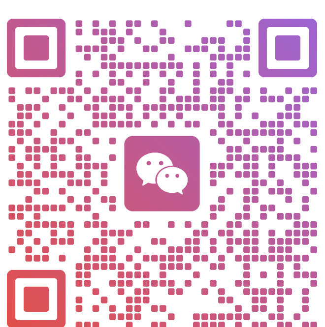

# kenton-reverse-lens

把“别人怎么做”翻译成“自己的品牌该怎么长”的 Agent Skill。

> 用着卡住了，可以找我答疑：99 元一个问题，24 小时内回。微信：JT_M0726

[crewup.cn](http://crewup.cn) · [Quickstart](docs/quickstart.md) · [故障排查](docs/troubleshooting.md) · [Issues](https://github.com/JefferyMaa/kenton-reverse-lens/issues) · [Discussions](https://github.com/JefferyMaa/kenton-reverse-lens/discussions) · [交流与反馈](#交流与反馈)

`kenton-reverse-lens` 面向博主、创作者或行业人物的单条到完整 corpus 分析。它先还原对方真实的想法、做法和方向，再剥掉资本、人力、规模和时代红利等外壳，用“一个人 + AI”的尺度反推品牌动作、能力结构和决策模型。

它不是通用摘要器，也不是把大佬打法原样复制到小团队的模仿模板。

## 你会得到什么

一次合格的输出包含两个主段：

1. **他的想法 / 做法 / 方向**：确认人物与账号类型，基于原始材料还原事实、步骤、数字和判断。
2. **反向分析**：先剥时代外壳，再回答你该怎么做、怎么搭建、怎么思考，并给出至少一个非显然连接。

证据不足的推断应标为 `⚪ 推断`，品牌方向应写成战略判断，而不是既成事实。

## 5 分钟 Quickstart

### 前置条件

- 一个支持目录式 `SKILL.md` 自定义 Skill 的 Agent 宿主。
- 一组你有权访问的视频、转写稿、文章或其他 creator corpus。
- 你的品牌目标或希望解决的战略问题。
- 需要有人在场参与判断；本 Skill 不应放入无人值守循环。

> 当前可执行资产只有 Skill 定义，不包含安装器、抓取器、下载器、ASR 或思维导图生成器。具体执行能力取决于 Agent 宿主及其工具。

### 安装

克隆仓库，然后复制到宿主文档指定的 Skills 目录：

```bash
git clone https://github.com/JefferyMaa/kenton-reverse-lens.git
cp -R kenton-reverse-lens <YOUR_AGENT_SKILLS_DIR>/
```

重新启动宿主或开启新会话，确认可用 Skill 列表中出现 `kenton-reverse-lens`。

### 第一次使用

首次测试建议提供一条可完整读取的材料和清楚的品牌目标：

```text
请用 kenton-reverse-lens 分析这位创作者的内容：<URL_OR_TRANSCRIPT>

我的品牌目标：<BRAND_GOAL>
```

你可以用以下标准判断是否成功：

- 先确认分析对象是谁、账号属于哪一类；
- 第一部分还原对方的想法、做法和方向，并锚定原始材料；
- 第二部分先完成“剥时代外壳”，再给出怎么做、怎么搭建、怎么思考；
- 事实与推断分开；
- 没有把资本级、团队级打法直接复制给“一个人 + AI”。

完整首次使用路径见 [Quickstart](docs/quickstart.md)。

## 适合与不适合

适合：

- 吃透一位创作者或行业人物的内容体系；
- 从多条内容中寻找可迁移的不变量、因果关系和矛盾；
- 把外部案例转换为自己的品牌战略、能力结构与判断准则；
- 分析访谈号、本人教学号或无脸剪辑号的不同价值层。

不适合：

- 只分析一个普通链接，不需要反推品牌——使用 [`kenton-link-lens`](https://github.com/JefferyMaa/kenton-link-lens)；
- 只需要视频摘要或逐字转写；
- 想自动抓取后无人值守地产出战略结论；
- 缺少原始材料，却要求把猜测写成事实。

## 两段式分析框架



| 阶段 | 核心问题 | 输出要求 |
|---|---|---|
| 对方的方法 | 他是谁，信什么，怎么做，往哪走 | 人物、想法、步骤、数字、方向与证据 |
| 剥时代外壳 | 哪些依赖资本、人力、规模或媒体红利 | 删除不可复制外壳，保留定位与杠杆 |
| 反向照自己 | 一个人 + AI 还剩什么可用 | 怎么做、怎么搭建、怎么思考 |
| 跨条连接 | 方法之间如何叠加、冲突或互为因果 | 至少一个非显然连接，逐步累积成图 |

## 账号类型

### 访谈号或本人教学

以内容中的真实人物为分析对象。每条内容形成一个方法论节点，记录其判断、方法、顺序和可迁移条件。

### 无脸剪辑号

同时分析两个层面：

- **运营模式层**：选人、切片密度、无脸规模化和流量路径；
- **内容方法论层**：被搬运内容中的真实方法、定位和杠杆不变量。

如果账号类型无法确认，先同时保留两个视角，不要过早删掉高价值方法论。

## 安全、隐私与诚实边界

- 只处理你有权访问、下载和分析的材料；
- 对外结果聚焦人物的思想、做法和方向，不泄露内部工具名、脚本名或内部 ID；
- ASR 同音错字和语义矛盾应标出，不按错误字面继续推演；
- 无法确认人物身份时先保留不确定性；
- 品牌建议属于战略推演，不应表述为已发生事实。

## 仓库内容

```text
.
├── SKILL.md
├── README.md
├── LICENSE
├── assets/
│   └── wechat-qr.png
├── docs/
│   ├── quickstart.md
│   └── troubleshooting.md
└── .gitignore
```

`SKILL.md` 是行为定义真源；README 和 `docs/` 解释如何安装、输入材料和验收结果。

## 已知限制

- 当前没有安装脚本、测试套件、示例 corpus 或 CI。
- 当前没有声明具体 Agent 宿主、版本或平台兼容矩阵。
- 抓取、下载、ASR、人物识别和思维导图能力不包含在本仓库中。
- 全 corpus 是否真的读取完整，必须根据来源清单和分析证据人工验收。
- Skill 明确要求人在场参与深度反向分析，不适合完全自动化运行。

遇到问题见 [故障排查](docs/troubleshooting.md)。

## 关于 Kenton Ma

Kenton Ma 是一名独立开发者，持续用 AI 构建真实能用的内容与工具。更多项目见 [crewup.cn](http://crewup.cn)。

## 交流与反馈

使用问题和可复现 Bug，请通过 [GitHub Issues](https://github.com/JefferyMaa/kenton-reverse-lens/issues) 提交；方法讨论可以进入 [GitHub Discussions](https://github.com/JefferyMaa/kenton-reverse-lens/discussions)。想交流个人品牌、“一个人 + AI”实践、获取项目动态或加入社群，可以扫码添加 Kenton Ma 微信，备注 `kenton-reverse-lens`。

<details>
  <summary>查看微信二维码</summary>
  <br>
  
  <p>若二维码失效，请访问 <a href="http://crewup.cn">crewup.cn</a> 获取最新联系方式。</p>
</details>

## License

本项目采用 [MIT License](LICENSE)。

## 联系 Kenton

- 个人博客：[Kenton Blog](https://kenton.crewup.cn/)
- 公开邮箱：[dilipkhandale351@gmail.com](mailto:dilipkhandale351@gmail.com)
